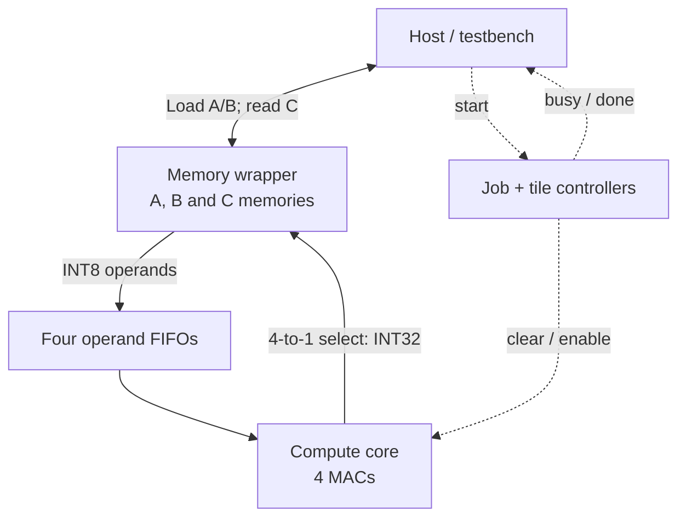

# GEMM Architecture Comparison

[](LICENSE)
[](rtl/)
[](https://github.com/AstuteFlamez/gemm-arch-comparison/actions/workflows/ci.yml)

A SystemVerilog comparison of two general matrix multiplication (GEMM)
architectures: a **2×2 systolic array** and a **conventional four-MAC design**.
The project evaluates correctness, execution time, and pre-layout power,
performance, and area (PPA) using matched hardware resources and test inputs.

Both cores support **8×8, 16×16, and 32×32 matrices**, with signed **INT8 inputs
and INT32 results**. Each computes 2×2 output tiles using four MACs; larger
matrices increase the work and storage, not the compute array size.

## Highlights

- **1,980 matrix multiplications checked:** both architectures passed the
  three-size, three-seed study against an independent mathematical reference.
- **100 MHz pre-layout timing target met:** both cores synthesized with
  Synopsys Design Compiler and the SAED32/28 standard-cell library.
- **Memory dominated the area:** at 32×32, the shared memory wrapper accounted
  for about **97% of mapped cell area**, helping explain the similar PPA results.

## System overview



The compute core is either the systolic array or the conventional design.
Solid arrows carry data; dashed arrows show selected control signals. The host loads A/B and
reads C while idle. During computation, the controllers load the FIFOs, run
one tile, and write its four results to C one word per clock.
See [datapaths, control, and timing](docs/ARCHITECTURE.md) for the details.

## Engineering decisions

I developed the architectures and RTL with AI assistance, chose the comparison
and experiment, and interpreted the results. The [AI usage notes](docs/AI_USAGE.md)
describe that division of work in more detail.

- **Match resources:** both designs use four copies of the same MAC, plus the
  same FIFO, memory wrapper, and top-level controller.
- **Compare operand delivery:** the systolic array forwards operands between
  neighboring PEs; the conventional design broadcasts each operand to two MACs.
  Both reuse data.
- **Keep the schedule comparable:** both load, compute, and store one 2×2 tile
  at a time. This makes the cost of systolic forwarding visible, while also
  exposing the limits of a design without overlapping load and compute phases.
- **Check behavior beyond arithmetic:** regressions cover reset, restart,
  repeated jobs, and start/busy/done handshakes as well as matrix results.

## Results and takeaway

At 32×32 and a 100 MHz clock, conventional took **266.24 µs**, versus
**271.36 µs** for systolic: about **1.9% less compute time**. Mapped area and
estimated total power were nearly tied, at approximately **0.597 mm²** and
**122.5 mW** for either core.

The systolic design spends two extra forwarding cycles per tile. With only
four MACs and a shared memory implementation dominating area, this study shows
how operand scheduling and storage can outweigh the difference between the
compute architectures. A larger matched array with more memory bandwidth and
overlapped loading would be the next experiment.

These are **pre-layout estimates for these two implementations**. Behavioral
memories mapped to registers and multiplexers, not SRAM macros. Compute time
includes internal tile loading; power covers the full load/compute/readback
transaction. See the [experiment, graphs, and raw reports](docs/EXPERIMENT.md)
for the measurement boundaries and limitations.

## Quick start

Install **Python 3.10+**, **Make**, and **Icarus Verilog** (`iverilog` and `vvp`).
From the repository root, compare both cores on 110 identical 8×8 matrix pairs:

```sh
make test-gemm-comparison MATRIX_DIM=8
```

Expected output includes:

```text
PASS: both cores match independent reference on 110 consecutive matrix pairs
PASS: 7040 outputs checked per core; no reset between jobs
Accepted-start to done: systolic 544 clocks; conventional 512 clocks
```

Logs, fixtures, and `cycles.csv` are written under `build/gemm-comparison/8/`.
For the full local regression, also install **Tcl** (`tclsh`), then run:

```sh
make check
```

This runs Python support tests, RTL unit/controller tests, both GEMM cores and
matched comparisons at all three sizes.
[GitHub Actions](.github/workflows/ci.yml) runs the same command on
pushes and pull requests. These checks use freely available tools; reproducing
the ASIC area and power study requires Synopsys and library access. See the
[setup guide](docs/SETUP_GUIDE.md) for the complete flow.

## Python tests

Requires **Python 3.10+**, **Make**, and **Tcl** (`tclsh`); no third-party
Python packages or HDL tools are needed. From the repository root:

```sh
make test-python
```

Checks reference calculations, test vectors, and report helpers; it does not
simulate RTL. The optional FPGA configuration check skips when `fpga/de2_115/`
is absent.

## Explore

- [Architecture and diagrams](docs/ARCHITECTURE.md)
- [Experiment, results, and graphs](docs/EXPERIMENT.md)
- [Setup and Synopsys instructions](docs/SETUP_GUIDE.md)
- [How I used AI](docs/AI_USAGE.md)

## Repository layout

```text
rtl/      Both GEMM cores and shared hardware
tb/       SystemVerilog testbenches
tests/    Python generators and support tests
scripts/  Simulation, synthesis, and plotting tools
docs/     Documentation, diagrams, and results
fpga/     Optional local DE2-115 demo (ignored by Git)
build/    Generated local outputs (ignored by Git)
```

## License

This project is available under the [MIT License](LICENSE).
