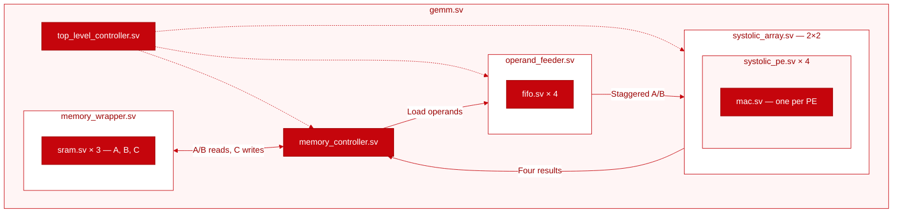

# RTL Learning Projects

Small SystemVerilog projects building toward an 8×8 GEMM using a 2×2 systolic array.

## GEMM architecture

Planned architecture; the current GEMM still uses one MAC. Boxes show which
modules belong together. Solid arrows show data flow; dashed arrows show control.
Completion handshakes are omitted for clarity.

## Implementation order

| Status | File | Done / remaining work |
| --- | --- | --- |
| DONE | [mac.sv](rtl/mac.sv) | Signed multiply-accumulate |
| DONE | [sram.sv](rtl/sram.sv) | Parameterized synchronous memory |
| IN-PROGRESS | [memory_wrapper.sv](rtl/memory_wrapper.sv) | Storage exists; finish module rename |
| IN-PROGRESS | [fifo.sv](rtl/fifo.sv) | Fixed 4×8 works; parameterize width/depth |
| NEXT | [systolic_pe.sv](rtl/systolic_pe.sv) | Forward A/B and validity; wrap one MAC |
| NEXT | [systolic_array.sv](rtl/systolic_array.sv) | Connect four PEs; verify one output tile |
| NEXT | [operand_feeder.sv](rtl/operand_feeder.sv) | Four FIFOs; stagger operands and validity |
| NEXT | [memory_controller.sv](rtl/memory_controller.sv) | Load FIFOs from SRAM; write four results |
| NEXT | [top_level_controller.sv](rtl/top_level_controller.sv) | Replace scalar sequencing with tile phases |
| NEXT | [gemm.sv](rtl/gemm.sv) | Integrate blocks; verify full 8×8 GEMM |
| LATER | [gemv.sv](rtl/gemv.sv) | Existing GEMV works; SRAM conversion |

## Repository layout

<pre>.
├── <a href="rtl/">rtl/</a>
│   ├── <a href="rtl/mac.sv">mac.sv</a>
│   ├── <a href="rtl/sram.sv">sram.sv</a>
│   ├── <a href="rtl/fifo.sv">fifo.sv</a>
│   ├── <a href="rtl/systolic_pe.sv">systolic_pe.sv</a>
│   ├── <a href="rtl/systolic_array.sv">systolic_array.sv</a>
│   ├── <a href="rtl/operand_feeder.sv">operand_feeder.sv</a>
│   ├── <a href="rtl/memory_wrapper.sv">memory_wrapper.sv</a>
│   ├── <a href="rtl/memory_controller.sv">memory_controller.sv</a>
│   ├── <a href="rtl/top_level_controller.sv">top_level_controller.sv</a>
│   ├── <a href="rtl/gemm.sv">gemm.sv</a>
│   └── <a href="rtl/gemv.sv">gemv.sv</a>
├── <a href="tb/">tb/</a>          # SystemVerilog testbenches
├── <a href="tests/">tests/</a>       # Python reference model, vectors, and tests
├── <a href="docs/">docs/</a>        # Design notes
├── <a href="scripts/">scripts/</a>     # Tool and environment checks
├── <a href="Makefile">Makefile</a>     # Build and test commands
└── <a href="README.md">README.md</a></pre>
