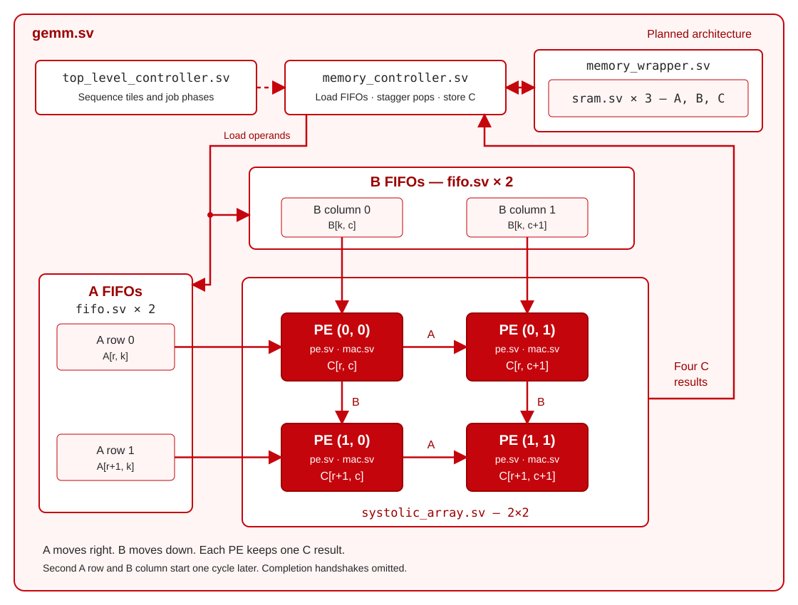

# RTL Learning Projects

Small SystemVerilog projects building toward an 8×8 GEMM using a 2×2 systolic array.

## GEMM architecture

Planned architecture; the current GEMM still uses one MAC.

## Implementation order

| Status | File | Done / remaining work |
| --- | --- | --- |
| DONE | [mac.sv](rtl/mac.sv) | Signed multiply-accumulate |
| DONE | [sram.sv](rtl/sram.sv) | Parameterized synchronous memory |
| IN-PROGRESS | [memory_wrapper.sv](rtl/memory_wrapper.sv) | Storage exists; finish module rename |
| DONE | [fifo.sv](rtl/fifo.sv) | Parameterized width/depth; pointers wrap at DEPTH-1 |
| NEXT | [pe.sv](rtl/pe.sv) | Forward A/B and validity; wrap one MAC |
| NEXT | [systolic_array.sv](rtl/systolic_array.sv) | Connect four PEs; verify one output tile |
| NEXT | [memory_controller.sv](rtl/memory_controller.sv) | Load four FIFOs; stagger pops and validity; write four results |
| NEXT | [top_level_controller.sv](rtl/top_level_controller.sv) | Replace scalar sequencing with tile phases |
| NEXT | [gemm.sv](rtl/gemm.sv) | Connect four FIFOs directly to the array; verify full 8×8 GEMM |
| LATER | [gemv.sv](rtl/gemv.sv) | Existing GEMV works; SRAM conversion |

FIFO verification: `make test-fifo-configs` passes all 16 combinations of depths
2/4/6/8 and widths 1/8/15/32, including ordering, pointer wraparound, reset,
simultaneous operations, and random checks. The `make test-fifo` testbench still
expects a 4-entry default; its instantiation needs updating for the FIFO's
8-entry default.

## Repository layout

<pre>.
├── <a href="rtl/">rtl/</a>
│   ├── <a href="rtl/mac.sv">mac.sv</a>
│   ├── <a href="rtl/sram.sv">sram.sv</a>
│   ├── <a href="rtl/fifo.sv">fifo.sv</a>
│   ├── <a href="rtl/pe.sv">pe.sv</a>
│   ├── <a href="rtl/systolic_array.sv">systolic_array.sv</a>
│   ├── <a href="rtl/memory_wrapper.sv">memory_wrapper.sv</a>
│   ├── <a href="rtl/memory_controller.sv">memory_controller.sv</a>
│   ├── <a href="rtl/top_level_controller.sv">top_level_controller.sv</a>
│   ├── <a href="rtl/gemm.sv">gemm.sv</a>
│   └── <a href="rtl/gemv.sv">gemv.sv</a>
├── <a href="tb/">tb/</a>          # SystemVerilog testbenches
├── <a href="tests/">tests/</a>       # Python reference model, vectors, and tests
├── <a href="docs/">docs/</a>        # Design notes
├── <a href="scripts/">scripts/</a>     # Tool and environment checks
├── <a href="Makefile">Makefile</a>     # Build and test commands
└── <a href="README.md">README.md</a></pre>
