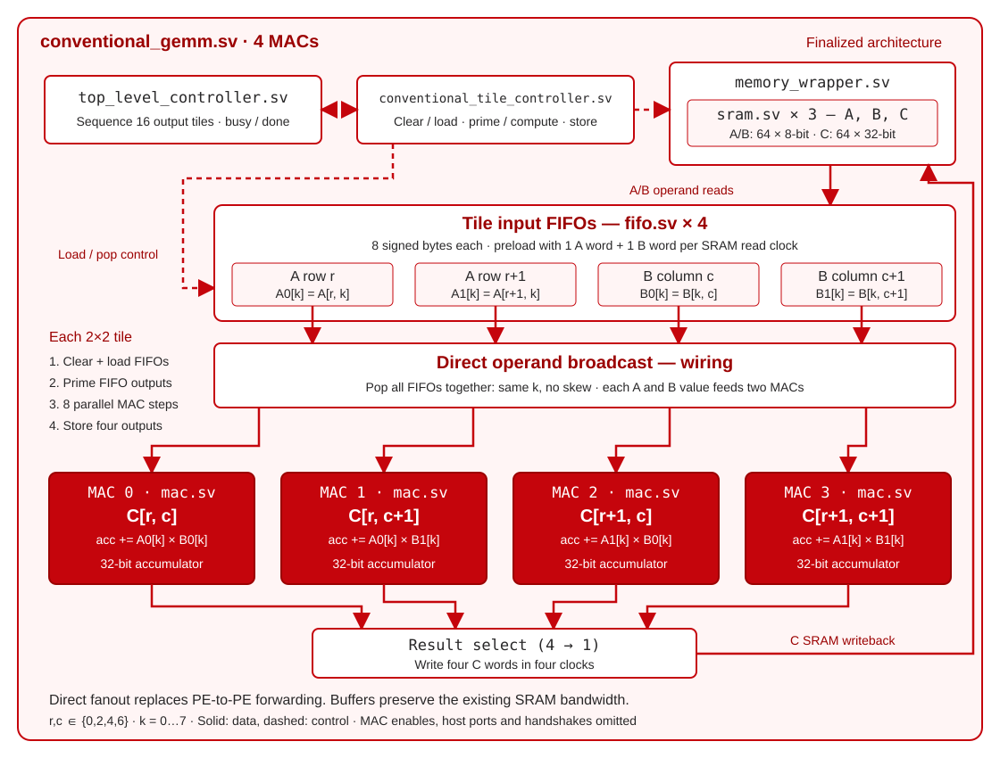

# Architecture

I tried to make the comparison fair by giving the **2×2 systolic array** and the
**conventional matrix multiplier** four copies of the same MAC. Both also use the
same FIFO, memory wrapper, and top-level controller.

Each GEMM core accepts **8×8, 16×16, or 32×32 matrices**, with signed **INT8 inputs**
and **INT32 results**. `MatrixDim` is set at compile time. Both calculate C in
2×2 output tiles, so increasing the input matrix size keeps the hardware at
**four MACs**.

## Systolic array

Each processing element contains a MAC and registers that forward operands.
**A moves right and B moves down**, while each PE accumulates one C element.
The second row/column input streams start one cycle later so matching operands
meet. Two extra forwarding cycles let the final products reach the farthest PE.

The compute hardware lives in [systolic_array.sv](../rtl/systolic_array/systolic_array.sv)
and [pe.sv](../rtl/systolic_array/pe.sv).
[systolic_gemm.sv](../rtl/systolic_array/systolic_gemm.sv) connects it to the
controllers, FIFOs, and memories.

## Conventional matrix multiplier

Four parallel MACs calculate the same four C elements. All four FIFOs pop the
same k together. Each A value feeds two MACs, and each B value feeds two MACs.
The operands are broadcast directly, so the MACs finish together without
forwarding between neighbors. This design also reuses data.

The four MAC instances and their operand connections are in
[conventional_gemm.sv](../rtl/conventional_matmul/conventional_gemm.sv).
The diagram keeps its original `naive-matmul.svg` filename.

## How one multiplication runs

1. Load A and B while the core is idle, then pulse `start`.
2. [top_level_controller.sv](../rtl/top_level_controller.sv) chooses each 2×2
   output tile in row-major order.
3. The architecture's tile controller loads two A rows and two B columns into
   four FIFOs, clears the accumulators, runs the MACs, and stores four results.
4. Repeat for all `(N / 2)²` tiles. `done` stays high until reset or the next
   accepted start; read C while idle.

The tile controllers organize the work. Arithmetic happens in
[mac.sv](../rtl/mac.sv). The memory wrapper selects host or internal access;
it doesn't schedule the multiplication. A/B reads and FIFO outputs are registered,
and C stores one result per clock.

Both cores handle repeated jobs **one pair at a time**, with no input queue or
overlap between loading, computing, and storing tiles. `rst` aborts a job;
internal `clr` signals start fresh tile accumulations. Reset does not erase
A/B/C memory contents.

In the ASIC study, these behavioral memories became registers and multiplexers,
not SRAM macros. That matters when interpreting the [experiment's results](EXPERIMENT.md).
