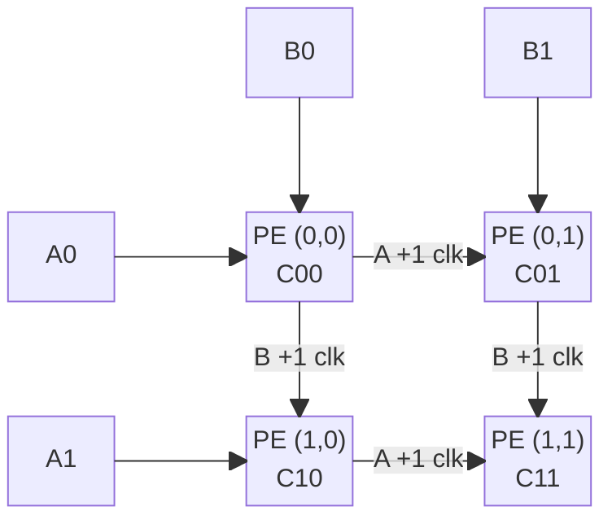
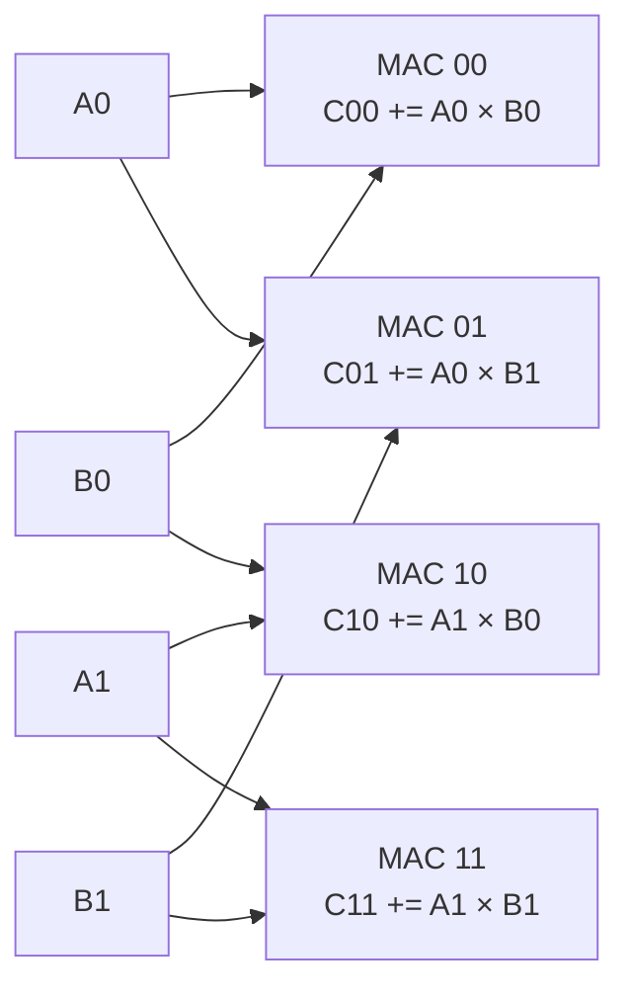
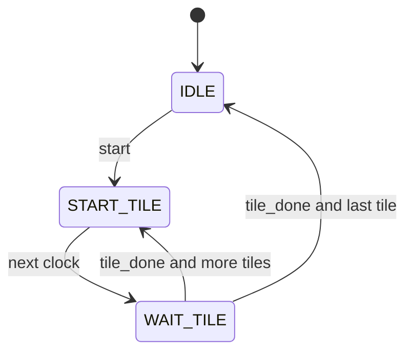
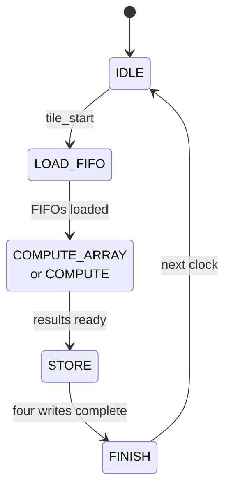
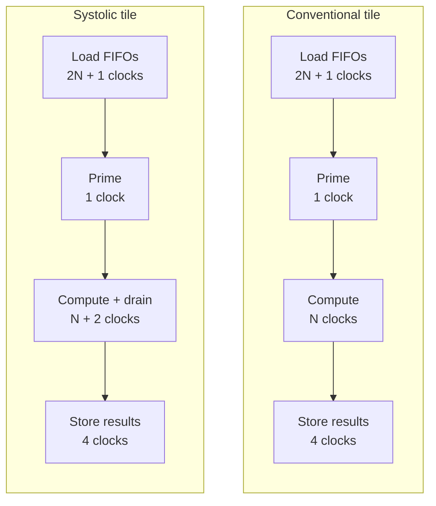

# Architecture

I tried to make the comparison fair by giving the **2×2 systolic array** and the
**conventional matrix multiplier** four copies of the same MAC. Both also use the
same FIFO, memory wrapper, and top-level controller.

Each GEMM core accepts **8×8, 16×16, or 32×32 matrices**, with signed **INT8 inputs**
and **INT32 results**. `MatrixDim` is set at compile time. Both calculate C in
2×2 output tiles, so increasing the input matrix size keeps the hardware at
**four MACs**.

## Systolic datapath

For a tile starting at row `r`, column `c`, the four FIFO streams are
`A0 = A[r,k]`, `A1 = A[r+1,k]`, `B0 = B[k,c]`, and `B1 = B[k,c+1]`.
Each stream carries signed 8-bit operands. C00, C01, C10, and C11 are the
tile's four signed 32-bit accumulators.

Each processing element contains a MAC and registers that forward operands.
**A moves right and B moves down**, while each PE accumulates one C element.
The A1 and B1 streams start one cycle after A0 and B0 so matching operands
meet. Each forwarding link adds one **enabled** clock of delay; disabling the
array holds operands and accumulators. Invalid input streams are replaced with
zero while the array fills and drains.

The compute hardware lives in [systolic_array.sv](../rtl/systolic_array/systolic_array.sv)
and [pe.sv](../rtl/systolic_array/pe.sv).
[systolic_gemm.sv](../rtl/systolic_array/systolic_gemm.sv) connects it to the
controllers, FIFOs, and memories.

## Conventional datapath

The same four FIFO streams feed four MACs directly. The connections below are
broadcast wires; there are no operand registers between MACs.

Four parallel MACs calculate the same four C elements. All four FIFOs pop the
same k together. Each A value feeds two MACs, and each B value feeds two MACs.
The operands are broadcast directly, so the MACs finish together without
forwarding between neighbors. This design also reuses data.

The four MAC instances, operand connections, and result selector are in
[conventional_gemm.sv](../rtl/conventional_matmul/conventional_gemm.sv).

## Control flow

### Full-matrix controller

[top_level_controller.sv](../rtl/top_level_controller.sv) visits all `(N / 2)²`
output tiles in row-major order. Load A/B while idle, then assert `start`.

`busy` is high outside `IDLE`; starts while busy are ignored. `tile_start`
lasts one clock. Full-matrix `done` stays high until reset or the next accepted
start. A held `start` can therefore launch another job when the core returns
to idle.

### Tile controller

Both tile controllers follow this sequence. The compute state is named
`COMPUTE_ARRAY` in the systolic controller and `COMPUTE` in the conventional
controller.

`FINISH` produces a one-clock tile completion pulse. Priming is cycle zero
inside the compute state, not a separate FSM state. Synchronous `rst` returns
both controllers to `IDLE` and clears their completion signals.

Sources: [systolic_tile_controller.sv](../rtl/systolic_array/systolic_tile_controller.sv)
and [conventional_tile_controller.sv](../rtl/conventional_matmul/conventional_tile_controller.sv).

## Timing comparison

Here `N = MatrixDim`. The diagram separates priming from active computation to
show where the two extra systolic clocks occur. Box widths are not to scale;
the counts exclude tile start/completion handshakes.

During systolic computation, C00 finishes on compute-state cycle `N`, C01 and
C10 on cycle `N + 1`, and C11 on cycle `N + 2`. All conventional accumulators
finish on cycle `N`. Cycle zero is the priming cycle in both designs.

Including controller handshakes, accepted-start-to-done latency is
`(N / 2)² × (3N + 10)` clocks for systolic and `(N / 2)² × (3N + 8)` for
conventional. At 8×8 this is **544 versus 512 clocks**; at 32×32 it is
**27,136 versus 26,624 clocks**, or **271.36 versus 266.24 µs** at 100 MHz.
These totals exclude host loading and readback and are checked by
[tb_gemm_comparison.sv](../tb/tb_gemm_comparison.sv).

## Memory and job boundaries

The tile controllers organize the work. Arithmetic happens in
[mac.sv](../rtl/mac.sv). The memory wrapper selects host or internal access;
it doesn't schedule the multiplication. A/B reads and FIFO outputs are registered,
and C stores one result per clock.

Both cores handle repeated jobs **one pair at a time**, with no input queue or
overlap between loading, computing, and storing tiles. `rst` aborts a job;
internal `clr` signals start fresh tile accumulations. Reset does not erase
A/B/C memory contents.

In the ASIC study, these behavioral memories became registers and multiplexers,
not SRAM macros. That matters when interpreting the [experiment's results](EXPERIMENT.md).
