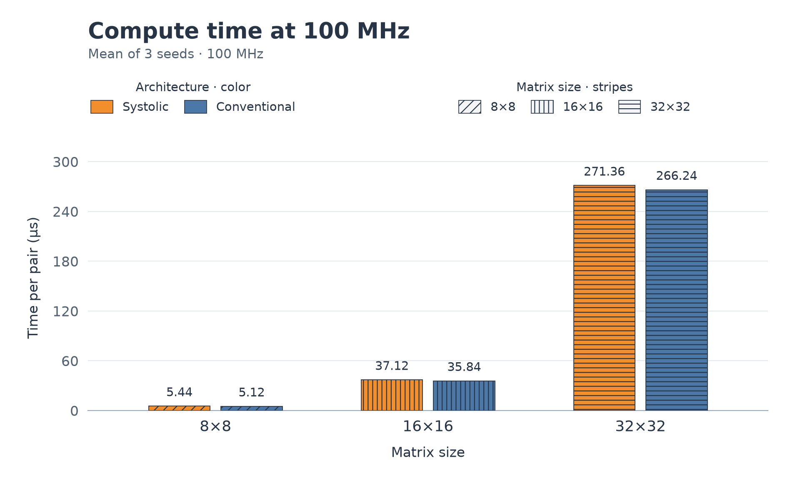
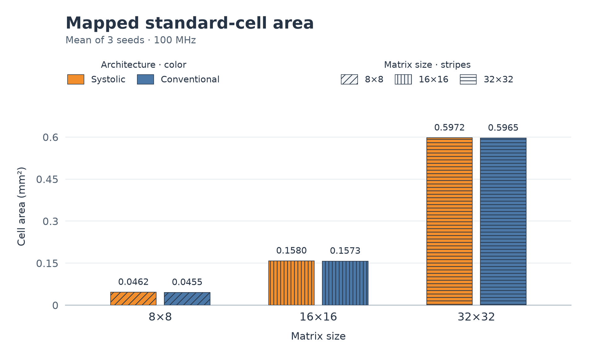
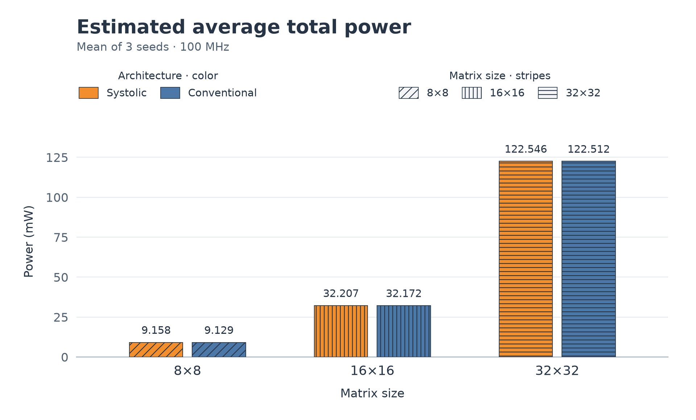

# Experiment

I first built both architectures before coming up with my hypothesis:

> Conventional wins in every PPA category by a little.

Honestly, this was disappointing after building the whole project because I was
hoping there would be a clear winner. But it ended up solidifying the importance
of design choices: how I feed the MACs and store the matrices matters too.

## How I carried it out

I used the **SAED32/28 standard-cell library** with Synopsys **Design Compiler**
for synthesis and **Power Compiler** for power estimates. Both cores used the
same **100 MHz clock**, typical corner, **1.05 V**, and **25 °C**.

With AI's help, I verified the testbenches using **VCS**, and I inspected a few
waveforms in **Verdi** myself. Each architecture ran 8×8, 16×16, and 32×32
multiplications with signed INT8 inputs and INT32 results. Each run used ten
directed warmups and 100 random A/B pairs; I repeated this with three seeds.
Both cores received the same inputs, for **1,980 checked multiplications** total.
The [setup guide](SETUP_GUIDE.md) has the commands.

## These were my findings

All correctness checks passed, and both cores met the timing target. At 32×32,
conventional took **266.24 µs** and systolic took **271.36 µs**: about **1.9% less
time** for conventional. Area and estimated total power were nearly tied, at
about **0.597 mm²** and **122.5 mW** for either core.

The charts show three-seed means, with the two architectures paired at each
matrix size. Orange is systolic; blue is conventional. Stripes indicate size:
diagonal for 8×8, vertical for 16×16, and horizontal for 32×32.



Accepted start through done, including internal tile loading. External loading
and readback are excluded.



Includes register-based storage; excludes placement and routing.



Dynamic plus leakage power over loading, computation, and readback. Seed ranges
are listed below; the bars show means only.

<details>
<summary>Regenerate the charts</summary>

From the repository root, use the plotting environment from the
[setup guide](SETUP_GUIDE.md#export-and-graph-the-results):

```sh
build/ppa-plot-venv/bin/python scripts/plot_experiment.py
```

The [plotting script](../scripts/plot_experiment.py) reads the recorded
`results.json` and writes the three PNGs in `docs/figures/`.

</details>

<details>
<summary>Values and seed ranges</summary>

| Size | Core | Time (µs) | Area (mm²) | Mean power (mW) | Seed power range (mW) |
| --- | --- | ---: | ---: | ---: | ---: |
| 8×8 | Systolic | 5.44 | 0.046180 | 9.1575 | 9.1552–9.1589 |
| 8×8 | Conventional | 5.12 | 0.045480 | 9.1291 | 9.1256–9.1310 |
| 16×16 | Systolic | 37.12 | 0.158027 | 32.2065 | 32.2046–32.2077 |
| 16×16 | Conventional | 35.84 | 0.157341 | 32.1724 | 32.1700–32.1746 |
| 32×32 | Systolic | 271.36 | 0.597239 | 122.5461 | 122.5442–122.5496 |
| 32×32 | Conventional | 266.24 | 0.596530 | 122.5116 | 122.5098–122.5152 |

Time and mapped area were identical across the three seeds. Values are rounded;
full precision is in the [recorded results](results/saed32-2026-10-08/results.json).

</details>

Conventional was slightly lower in all three headline numbers, but I wouldn't
call the tiny power difference a meaningful win. It also wasn't lower in every
power component. The systolic array needs two extra forwarding cycles per tile;
that overhead explains the timing gap, which shrinks as the matrices get larger.

The biggest limitation is that **both designs still have only four MACs**.
Increasing the matrix size gave them more work and storage. It didn't create a
larger compute array. At 32×32, the shared memory wrapper accounts for about
**97% of mapped area**, and both cores load operands before computing each tile.

These are pre-layout estimates, without routed wiring, a physical clock tree,
or gate-delay glitch activity. Memories map to registers, not SRAM macros.
Compute time includes internal tile loading; power covers external loading,
computation, and readback. These are different measurement windows.

## Predicting 64×64

Keeping four MACs and the same schedule predicts **2,068.48 µs systolic** and
**2,048.00 µs conventional** at 100 MHz. Area and power fits predict about
**2.36 mm² and 485 mW** for either core. These values are extrapolations;
64×64 support and timing were not tested. Prediction ranges show variation
between models, not confidence intervals.

<details>
<summary>64×64 estimates and model ranges</summary>

| Core | Time (µs) | Area (mm²) | Area model range (mm²) | Power (mW) | Power model range (mW) |
| --- | ---: | ---: | ---: | ---: | ---: |
| Systolic | 2,068.48 | 2.3590 | 2.1125–2.3590 | 485.009 | 442.447–485.009 |
| Conventional | 2,048.00 | 2.3582 | 2.1277–2.3582 | 484.960 | 443.041–484.960 |

Time uses the unchanged schedule at 100 MHz. Area and power use the `aN² + b`
fit; ranges span the three models in the
[prediction results](results/saed32-2026-10-08/results.json). These are not
simulation or synthesis results for 64×64.

</details>

## If I continued this experiment

I would increase the number of MACs in both designs and improve their memory
bandwidth so loading doesn't dominate the comparison. I would also overlap
loading with computation and compare the physical routing.

I predict systolic's local connections would become more useful with a larger
array. I'd still keep the MAC counts equal: a 32×32 systolic array has **1,024
MACs**, so its conventional comparison would need 1,024 too. That experiment
would give me a better way to test the scaling advantage I originally had in mind.

[Download the graphs](results/saed32-2026-10-08/ppa-graphs.pdf) ·
[Raw measurements](results/saed32-2026-10-08/measurements.csv) ·
[Models and predictions](results/saed32-2026-10-08/results.json) ·
[Review and limitations](results/saed32-2026-10-08/review.json) ·
[Reports and source snapshot](results/saed32-2026-10-08/reports.zip)
