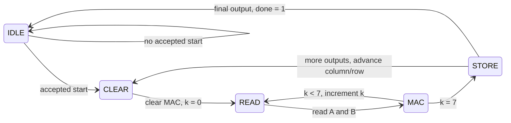

# GEMM: Matrix-Matrix Multiplication

This fixed 8 × 8 GEMM computes `C = A * B`. Each output is a dot product:
`C[row][column] = sum of A[row][k] * B[k][column]`, for k = 0 through 7.

## My implementation

The top-level wiring is in [rtl/gemm.sv](../rtl/gemm.sv).

- [gemm_controller](../rtl/gemm_controller.sv) owns the FSM, counters, addresses,
  memory/MAC requests, start acceptance, `busy`, and `done`.
- [gemm_memory](../rtl/gemm_memory.sv) owns A/B (64 × 8) and C (64 × 32) [SRAMs](sram.md),
  routes host/compute access, gates operations during reset, and converts signed reads.
- One [MAC](mac.md) processes signed INT8 operands and accumulates signed INT32 results.

Compute addresses: `A: row * 8 + k`, `B: k * 8 + column`, `C: row * 8 + column`.

## State machine

Before a READ edge, addresses and read requests select operands; after that edge,
SRAM outputs hold the operands. The following MAC edge consumes them directly.
STORE writes C. Each output takes 18 cycles; a job takes 1,152 after accepting start.

Load A/B in IDLE; accept `start` with reset low, including on the same edge as
an A/B write. Those final writes complete before computation reads the operands.
Busy host requests are ignored. `done` holds until reset or an accepted start.
At a rising edge, reset returns any state to IDLE and clears counters, done, and MAC.
Reset also gates memory operations, preserving stored data and SRAM read outputs.

C samples `c_rd_addr` every idle rising edge outside reset; `c_rd_data` updates afterward.
Its output holds while busy or reset. After done, keep start low and read on later idle edges.

## Verification

The [testbench](../tb/tb_gemm.sv) checks signed extremes, random matrices, input reuse,
start/write collisions, busy requests, reset, sticky done, synchronous reads, and timing.
`make test-gemm` passes 38 jobs and 2,433 comparisons, including exact 1,152-cycle jobs.
`make test-gemm-vcs` includes all modules but has not been run for this integration.
