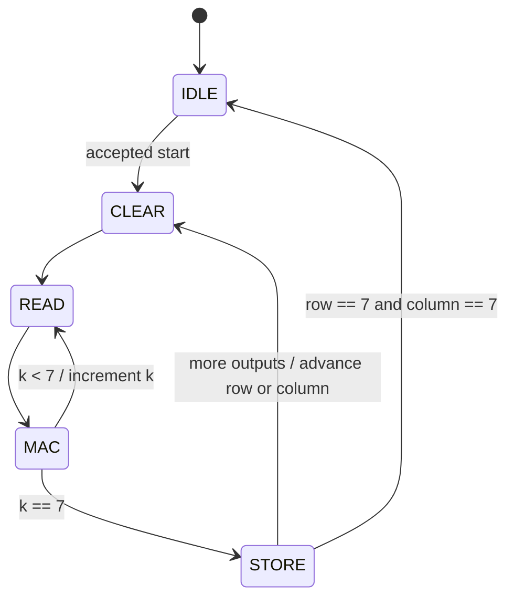

# GEMM: Matrix-Matrix Multiplication

GEMM multiplies two matrices. Each output is the dot product of one row of the
first matrix and one column of the second, which can be computed with repeated
[MAC operations](mac.md). This exercise computes `C = A * B`.

For my 8 × 8 implementation:

```text
C[row][column] = A[row][0] * B[0][column]
               + A[row][1] * B[1][column]
               + ...
               + A[row][7] * B[7][column]
```

For example, a row of `[1, 2, 3, 4, 5, 6, 7, 8]` multiplied by a column of all
ones produces `36` for that output element.

## My implementation

The RTL is in [rtl/gemm.sv](../rtl/gemm.sv).

- `A` and `B` are 8 × 8 matrices of signed 8-bit values.
- `C` is an 8 × 8 matrix of signed 32-bit results.
- One MAC is reused across all 64 output elements.
- Input operands are registered during a read cycle, then accumulated on the
  following clock edge.

Each matrix is stored in a flat array, with each element at address
`row * 8 + column`. Load all 64 elements of both input matrices before the first
calculation. Later calculations can reuse the loaded inputs.

`row` and `column` select the output element being calculated. `k` counts from
0 through 7, moving across that row of A and down that column of B. The output
row and column stay fixed while the eight products are accumulated:

```text
A read address = row * 8 + k
B read address = k * 8 + column
C write address = row * 8 + column
```

## State machine



- `IDLE`: Accept writes to A and B, or start a calculation. Both matrices can be
  written on the same clock edge. Either write enable takes priority over start.
- `CLEAR`: Clear the MAC accumulator and reset `k` to zero for the next output.
- `READ`: Register `A[row][k]` and `B[k][column]` as the MAC's operands.
- `MAC`: Accumulate the registered product. Increment `k` and return to `READ`,
  or move to `STORE` after the product for `k == 7`.
- `STORE`: Save the completed result. Advance the output column, or reset the
  column and advance the row after column 7. Finish after storing `C[7][7]`.

Each output takes 18 cycles: one to clear, eight pairs of read and MAC cycles,
and one to store. The full calculation finishes 1,152 cycles after the edge that
accepts `start`, excluding input loading.

`busy` stays high during the calculation, and writes and extra start requests
are ignored while busy. `done` goes high when the last result is stored and
stays high until reset or the next accepted start. Select an output with
`c_rd_addr` and read it asynchronously through `c_rd_data` after completion.

Reset is synchronous and returns the controller to `IDLE`, clears the counters,
accumulator, and `done`, and leaves the matrix arrays unchanged. Pulse `start`
for one clock; holding it high will start another calculation once the core is
idle and neither write enable is asserted.

## Verification

The [testbench](../tb/tb_gemm.sv) checks zero and all-ones matrices, left and right
identity multiplication, the largest positive and negative sums, input reuse,
and 20 seeded random matrix pairs. Expected results are calculated with a
SystemVerilog reference model using signed 32-bit arithmetic.

It also checks writes and extra starts while busy, write/start collisions, held
start, and reset during `CLEAR`, `READ`, `MAC`, and the first and final `STORE`
cycles. Each completed job checks all 64 outputs, completion at exactly 1,152
cycles, and `done` staying high during result reads.

Run locally with Icarus Verilog:

```sh
make test-gemm
```

On a configured VCS machine, use `make test-gemm-vcs`.
