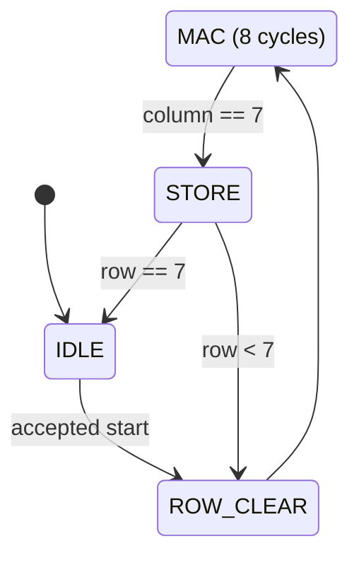

# GEMV: Matrix-Vector Multiplication

GEMV multiplies a matrix by a vector. Each output is the dot product of one
matrix row and the input vector, which can be computed with repeated
[MAC operations](mac.md).

For my 8 × 8 implementation:

```text
y[row] = A[row][0] * x[0] + A[row][1] * x[1] + ... + A[row][7] * x[7]
```

For example, a row of `[1, 2, 3, 4, 5, 6, 7, 8]` multiplied by a vector of all
ones produces `36` for that output row.

## My implementation

The RTL is in [rtl/gemv.sv](../rtl/gemv.sv).

- `A` is an 8 × 8 matrix of signed 8-bit values.
- `x` is an 8-element vector of signed 8-bit values.
- `y` is an 8-element vector of signed 32-bit results.
- One MAC is reused across all columns and rows.

The matrix is stored in a flat array, with each element at address
`row * 8 + column`. Load all 64 matrix elements and 8 vector elements before
the first calculation. Later calculations can reuse the loaded inputs.

## State machine



- `IDLE`: Accept matrix and vector writes, or start a calculation. Writes take
  priority over start.
- `ROW_CLEAR`: Clear the MAC accumulator and reset the column counter.
- `MAC`: Stay here for eight cycles, accumulating one product per clock across
  columns 0 through 7.
- `STORE`: Save the row's result, then move to the next row or finish.

Each row takes 10 cycles: one to clear, eight to accumulate, and one to store.
The full calculation finishes 80 cycles after the edge that accepts `start`,
excluding input loading.

`busy` stays high during the calculation, and writes and extra start requests
are ignored while busy. `done` goes high when the last result is stored and
stays high until reset or the next accepted start. Select an output with
`y_rd_addr` and read it through `y_rd_data` after completion.

Reset is synchronous and returns the controller to `IDLE`. Pulse `start` for
one clock; holding it high will start another calculation once the core is idle.

## Verification

I wrote the two testbenches with help from ChatGPT:

- [tb/tb_gemv.sv](../tb/tb_gemv.sv) checks row sums, a signed identity case,
  the largest positive and negative sums, and input reuse. Each case checks all
  eight outputs, completion at exactly 80 cycles, and `done` staying high during
  result reads.
- [tb/tb_gemv_regression.sv](../tb/tb_gemv_regression.sv) adds tests for writes
  and start requests while busy, write/start collisions, held start, and reset
  during different stages of a calculation. It also checks directed and seeded
  random cases generated by the [Python reference model](../tests/gen_vectors.py).
